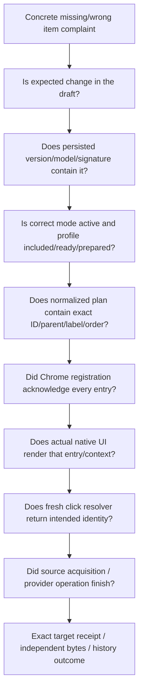

# Chrome parity and read-only first-divergence diagnosis

[Route](README.md) · [root causes](FORENSIC_LEGACY_VS_MODERN_ROOT_CAUSE.md) · [call census](FULL_CALL_AND_WRITER_CENSUS.md)

Four truths: **draft UI → persisted definition → registered/rendered native menu → provider result**. None proves the next. Current source 2e65ba137a35e1656b691fd2fdbf95082a0cdf4e; all reproduction registration below uses mocked Chrome, not installed extension.

## Identity/plan contract

Root redown. Simple quick:P or simple-option:P:S directly under redown, independent of folder depth. Nested root nested:P:R:R; child nested:P:R:N; branch nested:P:R:N:send. Actual immediate parent controls ancestry. Contexts link/image/video/audio/page. Built-ins setup if empty, separator, nested checkbox, saved-object URLs and manage destinations. Shared plan controls order/labels; Chrome controls platform geometry. The six-item ACTION_MENU_TOP_LEVEL_LIMIT in official API concerns extension-action context menus, not a general six-page-destination limit.

Current [contextMenus primary reference](https://developer.chrome.com/docs/extensions/reference/api/contextMenus), fetched200; capture hashes/excerpts in [primary references](evidence/phase-2/official-excerpts.json). Runtime creation errors surface through callback/runtime.lastError; code awaits parents with5s per-entry deadline. No actual installed callback failure was observed here.

At each failed boundary stop causal attribution at that layer. Do not repair/provision/change modes/rewrite profiles as a diagnostic read. Real profile projections must stay private/redacted; current internal profiles response can include secrets and is not a safe export API.

## Missing-item decision table

| Check | Read-only comparison | First failure / next proof |
|---|---|---|
| Draft | Visible card's stable ID, target and dirty status | Not yet added/selection incomplete; UI observation only |
| Saved | Compare approved redacted menu projection, version and expected signature | F1 unsaved, validation error, stale-save conflict, storage failure; source alone cannot pick one |
| Mode/filter | rightClickMode; explorerManaged/showInContextMenu; nested enabled; root/child ready; prepared same-account bucket | Inactive/excluded/legacy-only/unready/unprepared; distinguish hidden from removed |
| Plan | Same menuEntries exact ID,parent,order,title and resolver | Wrong label/order/ancestry or absent entry; naming F2 and migration F3 reproduced |
| Registered | Captured Chrome callback result, rebuild sequence/revision | F4 possible clear-on-error; no durable last-build receipt exists currently |
| Rendered | Actual native menu for matching link/image/page context, installed version/platform | Browser/platform/context issue; HTML screenshot does not show native UI |
| Click | fresh profiles/mode + exact ID resolved target | Stale/removed/invalid prepared target; tree: never fallback |
| Source | srcUrl > linkUrl > pageUrl; gallery branch; whether bytes remotely accessible | URL reference may be HTML, blob, expired or browser-authenticated; no generic byte guarantee |
| Provider | Worker readiness/auth/exact prefix/name/error/returned key | Ingest prefix validation not independent byte read-back; no live operation authorized |
| Feedback | optional notifications, toolbar/history/counter and partial/error status | Notification-off silence or late status overwrite is not evidence no mutation happened |

For stale IDs resolver returns null; no old default transfer. For mode/removal after resolve, already captured target can continue—no cancel guarantee. Saved URL action looks up successful history and session opaque token, not provider object truth. Source extraction for media prefers srcUrl even when wrapped in a hyperlink; page fallback is a reference, possibly HTML. Hitomi gallery handling is exceptional capture rather than generic ingestion.

## Installed acceptance required, not executed

Managed Chromium policy blocks arbitrary extension installs (read ExtensionInstallBlocklist=*); do not bypass it. Approved profile/environment should compare draft/saved/Chrome state at identical revision, restart/suspension/two-window races, eight-level output, mode-only dirty changes and callbacks; then separately approved disposable provider work checks exact account/bucket/prefix/key/bytes and history. No customer resource or real Chrome menu was changed here.
