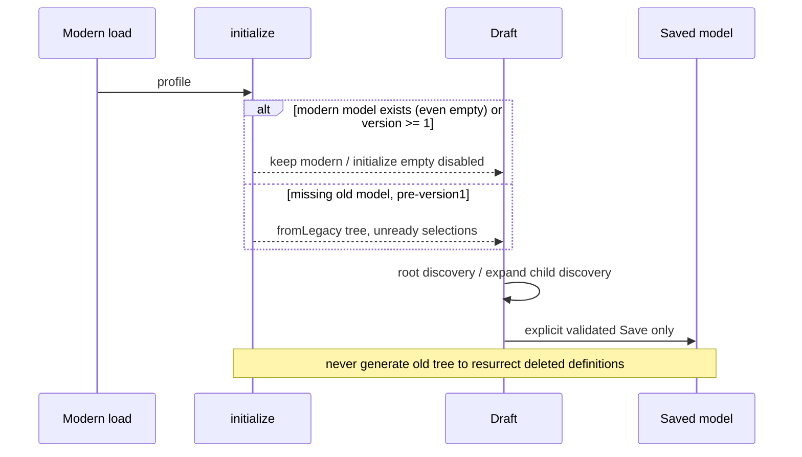

# Full bounded call/writer census

[Route](README.md) · [machine census](PHASE_2_SOURCE_INDEX.json) · [existing Map W](WIRING_AND_STATE.md)

Source 2e65ba137a35e1656b691fd2fdbf95082a0cdf4e. Lexical enumeration covers26 named source paths,447 named function declarations,243 event/storage/API sites and47 literal background message branches. Counts describe located text, not443 fully executed function contracts or complete dynamic closure. Anonymous/dynamic calls and library internals remain gaps; index site text is a lead, not permission to execute it.

## Owners and allowed writes

| Stage/owner | Read/transform/output | Actual writer/gate and effects | Primary anchors |
|---|---|---|---|
| UI load | storage profiles/mode, background profiles, clone, signature then initialize | Draft only; discovery may normalize readiness | destinations.js load/mountNested; nested initialize/fromLegacy |
| Simple actions | rows/included/update/renderSimple | Draft fields; account reassigns stable row to prepared profile; remove primary suppresses, extra filters | destinations.js update/renderSimple |
| Nested callbacks | context.save, run/render/rootRow/folderRow | Modern adapter dirties only; remote creation separately context.send | nested-menu-editor.js + Modern mount |
| Projection | fields/project/signature/prefix/validate | No store mutation; active mode validation | destination-config.js all six pure helpers |
| Definition save | latest profiles/mode/backup + expected | Exact Explorer sender; allowed menu fields on known IDs; queue; storage then rebuild | [background.js:2072 function saveDestinationConfig](../../extension/background.js#L2072) |
| Legacy preferences | latest profiles + preference patch | Exact options sender; name/folders/category/GitHub fields only; no membership/menu fields | [background.js:2057 function saveStoragePreferences](../../extension/background.js#L2057) |
| Infrastructure merge | latest menu fields over delayed profiles | destinationSaveQueue; preserves current menu/other profiles; one-profile exception for explicit setup | [background.js:786 async function setProfiles](../../extension/background.js#L786) |
| Explicit setup | discovered account/redown bucket/healthy Worker | exact Modern sender+confirmed:true, create/reuse bucket, provision if needed, seed one profile, preserve mode | setupRedownQuickDestination/cfSetupRedownQuick |
| Explicit activation | prepared bucket→profile | cfProvision derives menuActivation from sender; Legacy storage preparation cannot seed active menu | deployCloudflareProfile/provisionCloudflareProfile |
| Native mode | checked boolean→rightClickMode | same save queue, mode-only write/rebuild, no full definition validation | background redown-nested-mode branch |
| Raw storage events | profiles/mode changes | Rebuild, not model validation or external ACL; clean editor reload/dirty keeps draft | background/onChanged; destinations/onChanged |
| Menu normalization | mode/profiles→ordered descriptor plan | Pure menuEntries/nestedEntries; inactive filters/readiness ancestry | nested-locations.js |
| Native registration | parent-first IDs/contexts/labels | serialized rebuild; removeAll/create callbacks5s; clear partial error | background rebuildMenus/buildMenus |
| Click resolver | fresh saved model+mode+ID | Returns owner/prepared same-account target/exact prefix or null | destination-config.resolve |
| Transfer | selected URL→prepared Worker→R2→receipt | Preparation can deploy; Worker remote fetch/write; history/count after prefix check | ingestCloudflareAtPrefix, preparedProfile, checkedFetch, putNewDownload |

Profiles store menuConfigVersion, menuLabel, defaultPrefix, simpleBucketName, simpleOptions, simplePrimaryEnabled, simplePrimaryOrder, explorerManaged, showInContextMenu, menuOrder, nestedMenu, alongside private credentials. Signature is JSON([mode,menu projection]), not a cryptographic version. Inactive definitions are retained. BackupV1 contains menu projection/legacy trees, not secrets. Schema/migration version1 is distinct from extension version, API versions and Forever0.1.

## Six sequences

1. **Modern:** event→draft→project/signature→UI validate→message expected→save lane→fresh signature compare→menu-fields patch→background validate→storage→rebuild queue→menuEntries→removeAll/awaited create→click→fresh resolve→preparedProfile→ingest→key-prefix receipt→recordTransfer/counter/optional notify.
2. **Historical:** dropdown/field→profile mutation→scheduleSave180ms or immediate callback→whole profiles storage (Nested specialized merge)→storage listener→old buildMenus→old quick/simple/tree/nested resolution→shared R2 ingest. This autosave convenience carried stale-writer risk.
3. **Native mode:** checkbox→save lane→mode storage→clean UI reload OR dirty mode-only expected-mode rebase→rebuild; already-resolved transfer not cancelled.
4. **Empty version1:** roots empty/model present OR missing with version>=1→initialize empty/disabled→no fromLegacy import→no tree native output. Original menuTree evidence remains; deletion cannot resurrect it.
5. **Overlapping builds:** triggers→menuRebuildQueue chains build after prior settles→parent-first creation; late failure cleans partial plan. Queues are in-memory; termination is not a durable transaction.
6. **Accounts/IDs:** profile stable ID, account identity, bucket identity, root/node UUID, array/explicit order→descriptor ID→resolver same-account prepared target. Duplicate display names do not merge identity; duplicate IDs rejected on normal Save. Direct corrupt storage can bypass validation.

## Async/effect details and uncovered closure

- Modern Simple cfBuckets promise cache deduplicates per account without explicit TTL. Picker has64-entry/10s cache and12s read deadline; panel identity rejects late replies. Nested reads deduplicate per render; renderVersion/isConnected rejects old paints. A stale cache/profile list may affect discoverability; owner incidence unverified.
- save locks inputs/selects/buttons but not all native details/summary behavior; request has no overall explicit controller timeout. Rebuild timeout is per create, not one total Save deadline.
- Auth refresh uses Cloudflare lock/session check, may write auth even on discovery. R2 adapter marks dispatched ambiguous writes uncertain and does not replay them blindly; that adapter is not the native URL ingestion caller.
- Native ingest calls plain fetch without the R2 adapter's bounded message transport; do not import its guarantees. Exact special prefixes require Worker capability; generic native ingestion may prepare/repair, unlike Modern folder creation betaNoProvision.
- History/counter storage is serial under transfer-history lock and retains50 recent rows/archival attempt. Successful cloud write plus failed local history is possible; no atomic cross-provider commit.
- Gallery Hitomi branches are present; full session/ZIP/extraction, auth/provider retry and every file-grid command's dynamic closure are not exhaustively re-executed. Source links/unknowns remain explicit rather than claiming100%.

No legacy callbacks were reenabled, no writer replaced, and no runtime instrumentation added. Candidate future read-only inspection must use these owners instead of creating parallel state authority.

## Sequence diagrams (source-backed, no live execution implied)

### Modern definition save and transfer

```mermaid
sequenceDiagram
  participant U as Modern DOM
  participant D as Profile draft
  participant B as Background save lane
  participant S as storage.local
  participant C as Chrome contextMenus
  participant W as Worker/R2
  U->>D: update field / changed
  U->>B: saveDestinationConfig(expected,mode,project)
  B->>S: read current profiles/mode
  B->>B: exact sender + signature + patch fields + validate
  B->>S: set profiles/mode/first backup
  B->>C: removeAll; parent-first awaited create
  B-->>U: signature + menuUpdated (false if registration failed)
  C->>B: clicked ID + context
  B->>S: fresh profiles/mode
  B->>B: resolve active prepared target
  B->>W: prepare if needed; ingest exact prefix
  W-->>B: response key/location
  B->>B: prefix check; history/count/optional notify
```

### Historical Legacy immediate update

```mermaid
sequenceDiagram
  participant U as Legacy dropdown
  participant P as Historical profile model
  participant S as storage.local
  participant B as Old background builder
  U->>P: select path; invalidate descendants
  P->>P: scheduleSave (180ms) / Nested specialized save
  P->>S: whole profiles or merged nested model
  S->>B: onChanged profiles
  B->>B: old simple/nested/tree generation
  B-->>U: native output separate from HTML tree
```

### Native mode and dirty editor

```mermaid
sequenceDiagram
  participant C as Native checkbox
  participant B as destinationSaveQueue
  participant S as storage.local
  participant U as Modern editor
  C->>B: checked → mode only
  B->>S: set rightClickMode
  S-->>U: mode change
  alt dirty and mode-only event
    U->>U: rebase expected mode; keep definitions
  else clean
    U->>U: load saved snapshot
  end
  B->>C: queued rebuild
```

### Migration and intentional emptiness



### Serialized builds and callback failure

```mermaid
sequenceDiagram
  participant A as Trigger A
  participant B as Trigger B
  participant Q as menuRebuildQueue
  participant C as Chrome
  A->>Q: enqueue build A
  B->>Q: enqueue build B
  Q->>C: removeAll; create parent; await callback
  alt callback error/timeout
    Q->>C: removeAll partial entries
    Q-->>A: reject registration (saved state retained)
  else acknowledged
    Q->>C: create children in order
  end
  Q->>C: build B after A settles
```

### Identity and late state boundaries

```mermaid
sequenceDiagram
  participant P as Picker/discovery
  participant U as UI draft
  participant B as Click resolver
  participant S as Saved profiles
  P-->>U: response for account/bucket/epoch
  U->>U: reject obsolete render/panel; preserve IDs
  B->>S: current mode/model at click
  B->>B: match profile ID then root/node/option ID
  B->>B: prepared target same account/bucket
  alt stale/removed/unprepared
    B-->>U: optional inactive notice; no fallback transfer
  else valid
    B->>B: snapshot exact prefix before async provider work
  end
  Note over B,S: later mode/removal does not cancel an already-resolved operation
```

Auth expiry, service-worker suspension and all browser timing permutations are source-modeled here, not installed-runtime proof; durable recovery and provider completion remain independently unverified.

## Automatic mode writer and additional negative proof

Background buildMenus:2149 writes inferred rightClickMode when the stored value is absent/invalid. Historical menuMode inferred Nested from menuTree; current inference only examines nestedMenu.enabled. D7 reproduces old-only/no-mode state becoming nested historically versus simple currently. This is a conditional compatibility divergence, not evidence that a correctly stored explicit mode is ignored.

Repo-wide lexical search of storage local/sync writes plus setProfiles callers found actual profile/mode persistence sites in background.js at786/798/1026/1226/1333/1338/2068/2094/2149/2428. options.js retains an unreachable old simpleLabelFallback writer, but current builder no longer reads it. Source search is not a storage ACL against arbitrary injected scripts.

D8 supplies a synthetic colon-bearing profile ID. Normal Save accepts it and emits a native descriptor, while resolve splits on colon and returns null. This is a confirmed input-grammar gap; ordinary crypto.randomUUID creation does not produce such IDs, and no owner imported profile with this grammar was observed. Any later repair needs versioned imported-ID policy, not silent migration.
