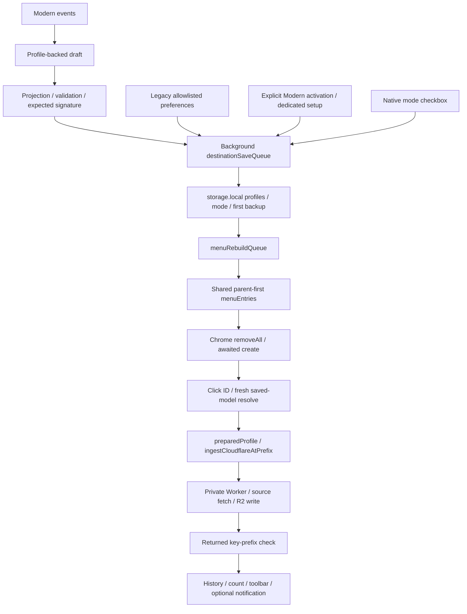

# Map W — end-to-end wiring and state

[Route](README.md) · [Modern events](MODERN_SOURCE_MAP.md) · [Security](CHROME_RUNTIME_AND_SECURITY.md)

CSS is intentionally absent. [Map V](PRESENTATION_AND_CSS.md) owns layout.

## Call/message graph

| Hop | Source/symbol (current lines in SOURCE_INDEX) | Input → output | Async/effect/error | Named evidence |
|---|---|---|---|---|
| Event → draft | destinations.js renderSimple / shared Nested render | Values/stable IDs → menu fields | changed marks dirty; context.save is draft-only | Simple additions; collapsed Nested nodes |
| Projection | destination-config fields/project/signature | profiles/mode → menu projection / JSON signature | No credentials in menu projection | stale concurrent saves |
| Validate | destination-config validate | proposed active layout → success/throw | Invalid IDs/path/labels/depth/count/unprepared rejected before persistence | invalid paths, duplicate IDs, unprepared buckets and excessive hierarchy |
| Message | destinations.js save/request | type/saveDestinationConfig, expected, mode, profiles → ok/signature/menuUpdated/error | Panel locked; no controller-level total timeout | storage failure preserves old config |
| Authority/persist | background saveDestinationConfig:2072 | Exact Explorer sender + expected signature + known IDs | Serialized; allowed fields; first menu backup; one profiles/mode/backup set | legacy preference lane; stale-save tests |
| Trigger | background onInstalled/onStartup/onChanged:2340; explicit save | Storage/event → rebuild queue | Redundant builds possible, serialized | parent callbacks/later rebuild |
| Normalize | nested-locations menuEntries/nestedEntries | profiles + mode → id/parentId/title/contexts | Stable order, immediate parents, no provider call | eight-level plan; flat Simple |
| Register | background buildMenus:2109 / finish | descriptors → Chrome API | Uniqueness/parent check; removeAll; each create callback timeout5s; clear partial menu on failure | native callback errors/retry |
| Resolve | destination-config resolve | clicked ID + fresh profiles/mode → profile/owner/prefix or null | Inactive/stale/old tree/unprepared rejected | production click listener exact account/bucket/prefix |
| Source/dispatch | background onClicked:2423; selectedUrl:751 | srcUrl then linkUrl then pageUrl → ingestion | Hitomi gallery exception; no default target fallback | click routing and destination-search tests |
| Provider | background ingestCloudflareAtPrefix:1970 | prepared target + exact prefix + URL/filename → receipt/location | Preparation can deploy; Worker public-HTTPS/redirect validation; ambiguous writes separate | explicit nested folder receipt |
| Outcome | background:1999/2497, transfer-counter | response.ok/body.ok + exact parent folder → history/count | Not independent byte read-back; cloud/history not atomic | receipt/history fixtures |

## Saved model

Profiles remain the database. Simple primary fields plus simpleOptions[{id,label,bucketName,prefix,order}]; nestedMenu={version:1,enabled,roots:[{id,bucketName,ready,label?,children:[{id,name,ready,label?,children}]}]}. rightClickMode is separate. menuConfigVersion=1 prevents repeated legacy import. menuConfigurationBackupV1 stores original menu projection/legacy trees/mode once, not authorization secrets.

initialize migrates missing old models only; fromLegacy splits prefixes into real segments and retains previousLabel, unready until discovered. Existing modern model including empty roots wins. Version1 missing model initializes empty/disabled. Migration creates no remote folders.

Background applies only RedownDestinationConfig.fields onto known profiles, preserving credentials/other profiles; validates active layout; writes then rebuilds. Account/bucket patch identity is not an overwrite route. UI changes account by moving definition ownership between existing prepared profiles.

## Seven concrete traces

1. **Simple add:** synthetic P/A/B, option S at root; choose photos/final; Save. Descriptor simple-option:P:S directly under redown; resolver selects currently prepared same-account B; ingestion folder photos/final.
2. **Nested child:** root R bucketB, N=photos, M=final. nested:P:R:M has parent nested:P:R:N and prefix photos/final. BranchN gets :send targeting photos. Label change does not change names.
3. **Last root removed:** roots=[] + version1 saves; output is setup + built-ins, no old menuTree resurrection. Group Undo can restore draft; saved emptiness survives reload.
4. **Native mode:** redown-nested-mode queues mode-only storage write then rebuild. Clean editor loads; dirty mode-only listener rebases signature mode and preserves draft. Native path does not full-validate dormant definitions.
5. **Other editor dirty:** A saves; B keeps draft with Reload warning. B save fails old signature. No automatic conflicting-definition merge.
6. **Click:** cosmetic droplet → fresh saved profiles/mode → resolve → source extraction → ingestion → prefix receipt validation → history/count/optional notification.
7. **Old ID:** tree:P:old never resolves/generates; inactive notice requested, possibly invisible with notifications off. No transfer/default-prefix fallback.

## Races and partial success

| Boundary | Protection | Remaining uncertainty |
|---|---|---|
| Delayed infrastructure profile write | setProfiles merge in same save lane | Direct storage writes bypass guard; dedicated setup has one-profile exception |
| Overlapping rebuild | menuRebuildQueue, awaited parent-first callbacks | No durable native revision transaction across suspension |
| Storage save succeeds, Chrome fails | ok:true/menuUpdated:false, Retry Save, partial-menu clear | Saved and actual native state can diverge; listener errors swallowed |
| Dirty mode-only event | Expected signature mode rebased | Profiles+mode event requires Reload; saving events ignored |
| Late discovery | Epoch/renderVersion/connected checks, picker cancellation | Auth refresh/timing permutations not fully tested; Simple bucket cache has no explicit TTL |
| Mode/removal while transfer pending | Fresh resolve before awaits snapshots target | No cancellation after resolve; gallery setup resolves again; suspension unknown |
| Folder create accepted, read-back fails | Explicit submit and verification | Folder may exist despite unchanged draft; never blind replay |
| Transfer succeeds, history fails | Separate caught outcome path | No atomic cloud/history/count transaction or durable resume promise |

Shared HTML picker caches64 pages, TTL10s after success, read timeout12s; closed panels ignore stale replies. These are not native Chrome-menu geometry controls.

## Phase 2 addendum — 30 October 2026

Phase2 adds [writer census and sequence diagrams](FULL_CALL_AND_WRITER_CENSUS.md), including buildMenus automatic mode write and Legacy-only inference change. Registered/rendered/provider truth remains independent.
