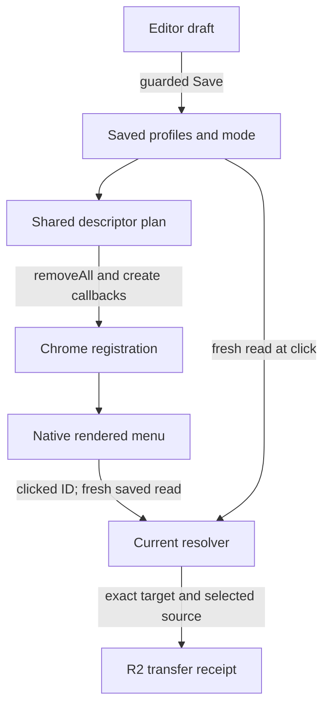

# Registration, render and transfer parity

30 October 2026. **AUDIT ONLY.** Source `b7178442c26c7723a9a650613ef65ba38ce26b21`. All implementation facts below are pinned source inspection unless a named local fixture is cited. No installed Chrome or live-provider verification. Proposed boundaries are documentation, not existing APIs or accepted Forever intent.

## Seven observable boundaries

| State | Owner / observable evidence | What it does NOT prove |
|---|---|---|
| Editor draft | current JS profiles, mode, dirty/reads, selected IDs | durable Save |
| Persisted | storage profiles/rightClickMode + C.signature | matching plan/registered native menu |
| Planned | M.menuEntries plus full background built-ins | actual Chrome acknowledgement |
| Registered | every awaited callback succeeded for the attempted build | actual platform rendering or a durable last-build version |
| Rendered | real Chrome menu in matching page/link/image/video context | current click resolves or source accessible |
| Click resolved | fresh saved profiles/mode + C.resolve | upload completed or bytes independently verified |
| Provider receipt/history | ingest prefix check, returned key, history/count | independent final-byte integrity or atomic remote/local commit |

## Actual native apply

background rebuildMenus:2103 chains buildMenus in menuRebuildQueue; failure does not poison future queue. buildMenus:2109 constructs description first, checks duplicate IDs/parent-before-child, annotates resolvable destinations, then calls removeAll. For each stripped descriptor it awaits Chrome create callback and runtime.lastError, with 5000ms per item. On create error/timeout it attempts removeAll cleanup and rejects. Initial removeAll rejection is outside that create try/catch. Queues are process-memory, not persistent transaction journals.

saveDestinationConfig writes storage first, awaits rebuild and returns ok:true/signature/menuUpdated:false on rebuild rejection. [P2](evidence/parity.json) proves the initial removeAll failure branch; [D3](evidence/prior-differential.json) proves create failure leaving saved state and zero mock entries. This is partial success, not a rollback and not a failed persistence claim. Retry Save with the acknowledged signature may rebuild. No live call performed.

onInstalled/onStartup register rebuildMenus; storage.onChanged for profiles/rightClickMode enqueues rebuild and catches failure silently. Thus one Save can cause both explicit and storage-triggered rebuilds in a real extension. The fixture storage does not automatically dispatch the browser event: overlapping-build tests exercise queue mechanics, not every event permutation. No durable build sequence/registered version/last-error store or actual menu enumeration API is supplied by this code. In particular menuUpdated acknowledges the awaited queued build, not permanent parity after later events.

Current runtime.id-absent fixture branch creates synchronously without awaited callbacks; it must not be used as browser proof. New parity background sets fixture runtime.id for current failure tests; historical oldPlan lacks it deliberately to inspect descriptor generation only.

## Native and source parity cases

P1 preserves full descriptor arrays and exact resolved target; generated extra IDs/default names differ rather than being concealed. P4 records historical third folder parent first-folder vs current immediate second-folder parent. P8 verifies depth8 and removal of obsolete :send. P10 executes current production click listener with page/link/image/video contexts and a stubbed provider boundary; srcUrl overrides linkUrl/pageUrl, deleted target yields notice/no ingest. No remote receipt is fabricated as real provider evidence.

Installed checklist, NOT_TESTED: load matching build in an administrator-approved disposable profile, prepare synthetic permitted state separately, capture each callback/order and native menu under all contexts, compare exact ID/title/parent/order/mode to immutable plan; test create/removeAll errors where safely instrumentable in a separate test build; restart/suspend mid-build; dirty/clean windows with native mode switch; verify later rebuild supersession. Do not bypass managed install policy or use customer resources. Live byte delivery requires separate authorization and target/key/size/content evidence.

## Source-backed boundary map

Each edge needs its own proof; no installed/live completion is inferred from this source map.
