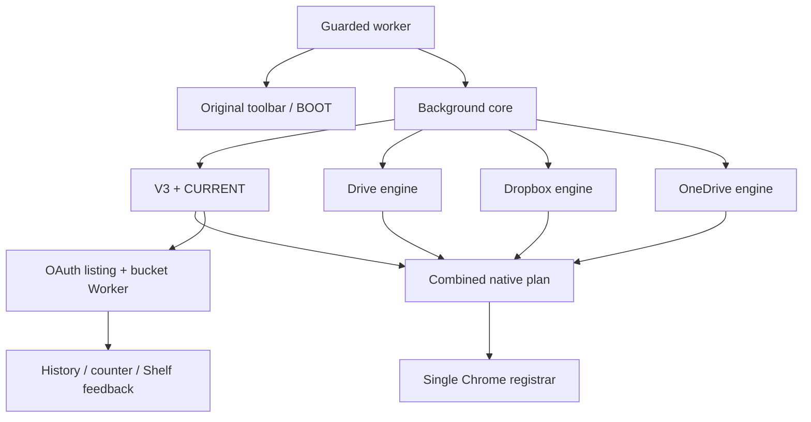

# Source census and executable boundaries

Source baseline: `1f85185f87c52b13e01c7c9069464668c2ad47d0`. Audit date: 2026-11-02 (America/Chicago). Documentation/evidence only. [Start here](00_START_HERE.md).

## Loaded runtime, not historical architecture

The extension is Manifest V3, version 0.5.27. Its classic service worker is `service-worker.js`, with no default popup, `shelf.html` as side-panel path, and `options.html` as settings. The manifest grants storage, identity, contextMenus, alarms, downloads, scripting, activeTab, webNavigation and sidePanel. Host access is broad, including HTTP/HTTPS wildcard access; this audit changes none of it. [extension/manifest.json:1–61](https://github.com/thanks-cohn/REDOWN/blob/1f85185f87c52b13e01c7c9069464668c2ad47d0/extension/manifest.json#L1-L61).

Evaluation order is operationally important:

```text
manifest → service-worker.js guarded import(background.js)
  background line 1 → entry-bootstrap.js
    toolbar-appearance.js → one action listener → boot.js → activation evidence
  background definitions, embedded WORKER_SOURCE
  history-archive → brand-icon → transfer-counter
  cloudflare-auth → cloudflare-api → nested-locations → destination-config → right-click-v3
  google-drive-menu → google-drive-provider
  dropbox-auth → dropbox-api → dropbox-menu → dropbox-provider
  onedrive-menu → oauth-diagnostic → onedrive-auth → onedrive-api → onedrive-provider
  right-click-current → rfis-index → runtime/explorer diagnostics → search-session
  provider install hooks, runtime handlers, menu rebuild and alarms
```

Sources: [extension/service-worker.js:1–45](https://github.com/thanks-cohn/REDOWN/blob/1f85185f87c52b13e01c7c9069464668c2ad47d0/extension/service-worker.js#L1-L45); [extension/background.js:1](https://github.com/thanks-cohn/REDOWN/blob/1f85185f87c52b13e01c7c9069464668c2ad47d0/extension/background.js#L1); [extension/background.js:908–966](https://github.com/thanks-cohn/REDOWN/blob/1f85185f87c52b13e01c7c9069464668c2ad47d0/extension/background.js#L908-L966); [extension/entry-bootstrap.js:1–152](https://github.com/thanks-cohn/REDOWN/blob/1f85185f87c52b13e01c7c9069464668c2ad47d0/extension/entry-bootstrap.js#L1-L152). Importing a file does not make every historical function reachable. `right-click-legacy.js` is used by tests/history, but is not imported by the current service worker. `addNestedLocations` and direct-default writer parameters survive in background; current `buildMenus` instead invokes V3 projection and supplies descriptor collectors to controls. Do not delete those helpers in a documentation run.

## Ownership and call inventory

| Owner | Current caller → operation → output | State / side effects | Evidence |
|---|---|---|---|
| Guarded wrapper | Chrome activation → import core → ready/failed flag | fallback original toolbar; Debug BOOT message only | bootstrap-observation.json; [extension/service-worker.js:1–45](https://github.com/thanks-cohn/REDOWN/blob/1f85185f87c52b13e01c7c9069464668c2ad47d0/extension/service-worker.js#L1-L45) |
| Entry bootstrap | toolbar gesture → sidePanel.open → window-scoped readiness → bounded attached-popup recovery | toolbar preference, bounded entry evidence; no provider prerequisites | entry-point focused tests; entry-bootstrap |
| V3 domain | builder/resolver/UI → validate / project / resolve / discover | pure except injected listing/clock/timers; only Cloudflare prepared profiles | [extension/right-click-v3.js:1–300](https://github.com/thanks-cohn/REDOWN/blob/1f85185f87c52b13e01c7c9069464668c2ad47d0/extension/right-click-v3.js#L1-L300) |
| Setup controller | Explorer script → load/draw/change/flush/Apply | draft, folders Map, expanded Set, session recovery; background messages | [extension/beta/right-click-v3-ui.js:1–255](https://github.com/thanks-cohn/REDOWN/blob/1f85185f87c52b13e01c7c9069464668c2ad47d0/extension/beta/right-click-v3-ui.js#L1-L255) |
| Background configuration | V3 messages → destinationSaveQueue → commitV3Current | expected revision checks, durable commit then local mirror, registration | [extension/background.js:2113–2560](https://github.com/thanks-cohn/REDOWN/blob/1f85185f87c52b13e01c7c9069464668c2ad47d0/extension/background.js#L2113-L2560) |
| Directory durability | commitPatch/readState → IDB state/records/journal/pointers/backups | one IDB transaction; no native Chrome atomicity | [extension/right-click-current.js:1–124](https://github.com/thanks-cohn/REDOWN/blob/1f85185f87c52b13e01c7c9069464668c2ad47d0/extension/right-click-current.js#L1-L124) |
| Listing | browse/discover → cfDestinationFolders/listObjectsPage → Cloudflare REST | OAuth refresh may update auth; optional RFIS observations | [extension/background.js:1448–1478](https://github.com/thanks-cohn/REDOWN/blob/1f85185f87c52b13e01c7c9069464668c2ad47d0/extension/background.js#L1448-L1478); [extension/background.js:3119–3132](https://github.com/thanks-cohn/REDOWN/blob/1f85185f87c52b13e01c7c9069464668c2ad47d0/extension/background.js#L3119-L3132) |
| Activation | explicit confirmed Explorer command → accounts/buckets → preparedProfile → verified profile → scopes | can deploy Workers; never run as audit read | [extension/background.js:2201–2288](https://github.com/thanks-cohn/REDOWN/blob/1f85185f87c52b13e01c7c9069464668c2ad47d0/extension/background.js#L2201-L2288) |
| Registrar | lifecycle/storage/Apply/BOOT repair → rebuildMenus/reconcileMenus/buildMenus | single native writer lane; local receipts and ID cache | [extension/background.js:2374–2560](https://github.com/thanks-cohn/REDOWN/blob/1f85185f87c52b13e01c7c9069464668c2ad47d0/extension/background.js#L2374-L2560) |
| Click | contextMenus.onClicked → provider dispatch or resolveActiveRightClick → saveResolvedRightClick | current authority; no stale default fallback | [extension/background.js:2867–2959](https://github.com/thanks-cohn/REDOWN/blob/1f85185f87c52b13e01c7c9069464668c2ad47d0/extension/background.js#L2867-L2959) |
| Transfer | ingestCloudflareAtPrefix → preparedProfile(noProvision) → Worker POST → exact key receipt → headObject | real network and History; source URL metadata | [extension/background.js:2008–2047](https://github.com/thanks-cohn/REDOWN/blob/1f85185f87c52b13e01c7c9069464668c2ad47d0/extension/background.js#L2008-L2047); [extension/background.js:2941–2957](https://github.com/thanks-cohn/REDOWN/blob/1f85185f87c52b13e01c7c9069464668c2ad47d0/extension/background.js#L2941-L2957) |

[Machine census](evidence/source-census.json) records SHA-256, line count, function declarations, literal imports, lifecycle/native/storage references for 74 non-vendor files. This is an explicitly limited static census, not a complete JavaScript parser or proof that all references execute. The tables and traces here supply reviewed dynamic wiring. Hashes apply to pinned HEAD; do not transplant line numbers to another revision.

## Every native contributor and writer

`background.js` is the sole current production file calling native create/update/remove. `ensureMenuAccess` maintains `redown` and `redown-manage`; `buildMenus` registers the assembled descriptor; obsolete provider IDs and reordered destinations are removed there. No current production `removeAll` call was found. Tests contain their own simulated APIs, which are not extension writers. `addNestedLocations` and `addMenuControls` have native-default callbacks, but current caller wiring uses collectors where invoked; retired historical imports are not a second active registrar. Census native-reference entries make these residual paths reviewable.

Contributors are Cloudflare V3, Google Drive, Dropbox and OneDrive. Google Drive owns `provider:google-drive`, Dropbox `provider:dropbox`, OneDrive `provider:onedrive`, Cloudflare `v3:*`, plus root/control IDs in background. Composition validates parent order and IDs; combined descriptors are checked again. Provider label text never identifies routes. Sources: [extension/google-drive-menu.js:1–40](https://github.com/thanks-cohn/REDOWN/blob/1f85185f87c52b13e01c7c9069464668c2ad47d0/extension/google-drive-menu.js#L1-L40), [extension/dropbox-menu.js:1–15](https://github.com/thanks-cohn/REDOWN/blob/1f85185f87c52b13e01c7c9069464668c2ad47d0/extension/dropbox-menu.js#L1-L15), [extension/onedrive-menu.js:1–38](https://github.com/thanks-cohn/REDOWN/blob/1f85185f87c52b13e01c7c9069464668c2ad47d0/extension/onedrive-menu.js#L1-L38), [extension/background.js:2457–2501](https://github.com/thanks-cohn/REDOWN/blob/1f85185f87c52b13e01c7c9069464668c2ad47d0/extension/background.js#L2457-L2501).

## Failure dependencies versus file separation



Independent provider files do not deliver independent startup or registration. A synchronous import failure can prevent later provider installs. A V3 projection exception occurs before composition and blocks new registration of all contributors, although existing Chrome rows/root recovery can survive. Dropbox composition calls a helper hosted on `RedownGoogleDriveMenu`; it requires a Drive heading. OneDrive composition requires a Dropbox predecessor. These are concrete departures from a narrowly neutral registrar boundary. No non-S3 provider source directly imports V3, but shared background boot and composition are real dependencies. Explorer's Setup is the only authorized V3 editing page; native registration does not need its DOM, but browsing and setup currently depend on its UI and Cloudflare listing backend.

IF the core import fails, THEN the wrapper attempts the same original entry bootstrap. IF that bootstrap already registered, THEN it is not registered again. IF a V3 plan throws, THEN new combined registration fails while base access recovery is attempted. ELSE a valid combined plan reaches one serialized native writer. The separate wrapper fixture observes one toolbar listener and zero menu listeners for both early and late import faults; this is local VM evidence, not installed Chrome.

[Reviewed machine-readable dependency/ownership map](evidence/reviewed-dependencies.json) complements the literal source census with callers, callees, state, side effects and evidence boundaries. It is a documentary graph, not a new normative Forever Works entity format. Provider install hooks execute immediately after their corresponding imports (Drive before Dropbox before OneDrive); later import failure can leave earlier side effects registered. The source wrapper remains the outer error boundary.
